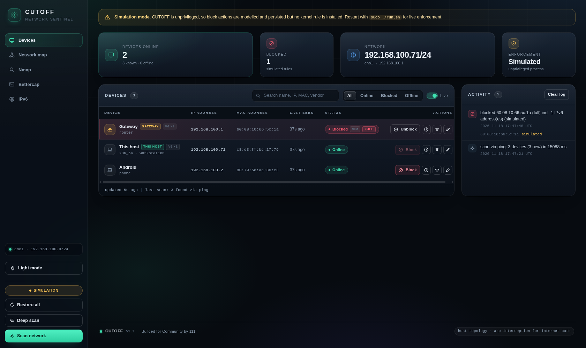
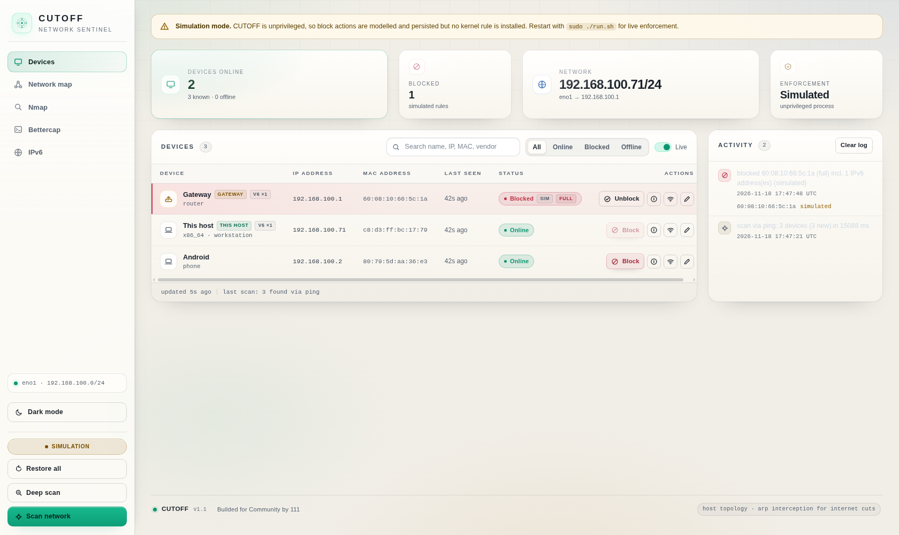

# CUTOFF

**See every device on your LAN. Learn what it is. Cut its access — IPv4 and IPv6 — from one page.**

CUTOFF is a local web console for a network you administer: it sweeps the subnet,
fingerprints what it finds, and enforces blocks through the platform firewall,
ARP interception and (where the hardware allows) Wi-Fi deauthentication. It is a
Flask backend plus a zero-build HTML/CSS/JS frontend, binds to `127.0.0.1`, and
installs globally as a single `cutoff` command.

[](LICENSE)
[](https://www.python.org/)
[](#platform-support)
[](tests/)



---

## Contents

1. [What it does](#what-it-does)
2. [Install](#install)
3. [Quick tour](#quick-tour)
4. [How blocking works](#how-blocking-works)
5. [IPv6](#ipv6)
6. [Wi-Fi deauthentication](#wi-fi-deauthentication)
7. [Nmap console](#nmap-console)
8. [Bettercap console](#bettercap-console)
9. [The `cutoff` command](#the-cutoff-command)
10. [API](#api)
11. [Configuration](#configuration)
12. [Data, tokens and backups](#data-tokens-and-backups)
13. [Platform support](#platform-support)
14. [Troubleshooting](#troubleshooting)
15. [Architecture](#architecture)
16. [Development and tests](#development-and-tests)
17. [Limits](#limits)
18. [License](#license)

---

## What it does

| Area | Capabilities |
|---|---|
| **Discovery** | ARP sweep (raw `AF_PACKET`, root) with ping + neighbour-table fallback; self-host row; subnet bounds; inventory that marks devices offline instead of deleting them; 5-minute "recent" window so phones don't flap |
| **Fingerprinting** | mDNS instances and models, NetBIOS, SSDP/UPnP, HTTP titles + `Server`, TLS certificate (subject/issuer/SAN), SNMP `sysName`/`sysDescr`, reverse DNS, DHCP leases, bundled OUI vendor table |
| **IPv4 enforcement** | iptables/ip6tables tagged chains, MAC and IP rules, bidirectional, idempotent + verified, persisted across restarts |
| **ARP black hole** | Bidirectional forged ARP on host topology, 2 s refresh, TTL cap, restore on exit, `ip_forward` guard |
| **IPv6 enforcement** | MAC rules that survive SLAAC rotation, per-address `-s`/`-d` rules, `/64` prefix blocks, NDP inventory, **one-click merged block** |
| **Wi-Fi** | `hostapd_cli` deauth when this host is the AP, monitor-mode frame injection otherwise, honest refusal when the hardware can't |
| **Tooling** | Bundled nmap 7.92 (7 presets) and bettercap 2.41.7 (4 presets), driven from the UI with server-side whitelists |
| **Console** | Glass/bento UI, off-white + dark themes with a persisted toggle, live topology map, audit log, toasts, keyboard and reduced-motion support |
| **Operations** | Global install + `cutoff` CLI, hardened systemd unit, waitress, log rotation, 0700 data dir, 0600 token, backups, doctor self-check |
| **Safety** | Simulation whenever privileges are missing, guardrails (own MAC, gateway, multicast, invalid input), explicit scope warnings in every response |

---

## Install

### Requirements

- **Python 3.10+** (`python3-venv` on Debian/Ubuntu)
- **Linux**: `iptables` and `ip6tables` (nft backend is fine), root for live enforcement
- **Windows**: Administrator + Npcap (auto-installed) for ARP; Windows Firewall for rules
- Internet **once** — for Python packages, and for the bundled tools if `vendor/` is empty

### Linux — one command, global `cutoff`

```bash
git clone https://github.com/unknownumair/cutoff.git
cd cutoff
./tools/fetch-vendor.sh          # optional: nmap + bettercap into vendor/
sudo ./tools/install-global.sh
```

The installer:

1. copies the app to `/opt/cutoff` (overridable: `CUTOFF_PREFIX`),
2. builds its own virtualenv and installs the pinned requirements,
3. creates `/var/lib/cutoff` with mode `0700` (overridable: `CUTOFF_DATA_DIR`),
4. writes `/usr/local/bin/cutoff` (overridable: `CUTOFF_BIN_DIR`),
5. writes and starts a hardened `cutoff.service`.

```bash
cutoff                 # start (systemctl start cutoff)
cutoff status          # version, paths, URL, port, service state
cutoff logs            # journalctl -u cutoff -f
cutoff stop | restart
cutoff serve           # run in the foreground instead of systemd
cutoff url | token     # http://127.0.0.1:8848/  |  the API token
cutoff doctor          # live plumbing self-check (--apply adds a dummy rule)
cutoff update          # reinstall from the checkout you run it in
sudo cutoff uninstall  # remove service, binary, install dir and data
```

**First-run shortcut.** `sudo ./run.sh` performs the global install on its first
run, then serves the installed copy. After that, `cutoff` is all you need.
Developers who want to run the checkout itself:

```bash
CUTOFF_NO_INSTALL=1 ./run.sh
```

### Windows — `%ProgramData%\CUTOFF` + `cutoff` command

Double-click **`run.bat`** (right-click → Run as administrator). On the first run it:

1. elevates to Administrator,
2. installs the app to `%ProgramData%\CUTOFF` and builds its venv,
3. writes `cutoff.cmd` / `cutoff-doctor.cmd` and appends that folder to the
   machine `PATH` — `cutoff` then works in any new terminal,
4. downloads and silently installs **Npcap 1.90** (WinPcap-compatible mode) if missing,
5. downloads portable **nmap 7.92** and **bettercap 2.41.7** into `vendor\`,
6. starts the console.

The same install runs directly from `tools\install-global.bat`. If it fails,
`run.bat` falls back to running from the folder. Npcap ships under its own
license and may ask for a reboot.

### Bundled binaries are not in git

`vendor/` holds ~190 MB, so it is git-ignored. Restore it with:

```bash
./tools/fetch-vendor.sh     # install-nmap-rpm.sh + install-bettercap.sh
```

Without it the console still runs; the Nmap and Bettercap pages report the tool
as unavailable instead of failing.

### From source, without installing

```bash
python3 -m venv .venv
.venv/bin/pip install -r backend/requirements.txt
CUTOFF_SIMULATE=on .venv/bin/python backend/app.py   # safe: no kernel changes
```

Open <http://127.0.0.1:8848/>. The API token is baked into the page for loopback
clients, so there is no paste step. Binding beyond localhost requires
`CUTOFF_TOKEN_INJECTION=0` and the token from `data/api_token`.

### Modes

| Mode | When | Behaviour |
|---|---|---|
| **Live** | root / passwordless sudo (Linux) or Administrator (Windows) | real ARP scan, real firewall rules, real ARP block |
| **Simulation** | unprivileged, or `CUTOFF_SIMULATE=on` | discovery still works (ping + neighbour table); blocks are modelled, shown and persisted, but no kernel rule is written. A banner says so on every page. |

`CUTOFF_SIMULATE=auto` (default) picks simulation only when the process cannot
enforce.

---

## Quick tour



### `/` — Devices

- Four KPI cells (online, blocked, network, enforcement) in a bento row whose
  lead cell carries the accent.
- Search (name/IP/MAC/vendor), status filters, live-refresh switch.
- Per row: name + tags (`this host`, `gateway`, `v6 ×N`), IP, MAC, vendor, last
  seen, status, and **Block / Unblock / Details / Wi-Fi cut / Rename**.
- **Block dialog:** mode (Everything / MAC only / IP only), isolation (complete /
  internet-only), an IPv4 + IPv6 summary of what will be cut, optional "block the
  whole IPv6 /64", gateway force-guard, and scope notes.
- **Details:** every probe field — mDNS instance, UPnP model, TLS certificate,
  SNMP, nmap ports/services/scripts, IPv6 addresses, raw JSON.
- **Activity:** audit trail of scans, blocks, renames, deauths, restores.
- **Restore all** (panic): removes every rule, stops interception, clears blocks.

### `/map` — Network map

Gateway-centred SVG topology: nodes coloured by status (active, blocked,
offline), self-host halo, dashed blocked links, hover tooltip, click for a detail
card, legend, live refresh.

### `/nmap` — Nmap console

Seven presets, target picker (whole subnet / gateway / inventoried device /
custom IP or CIDR validated to your subnet), host table (ports, OS, scripts), raw
output pane, Stop that reports "scan stopped by user", and responsive-host sync
back into the inventory.

### `/bettercap` — Bettercap console

Four presets (recon, sniff, full LAN monitor, HTTP proxy), target multi-select,
live REPL log with ANSI stripped, start/stop/clear, and a refusal instead of a
dead session when not root.

### `/ipv6` — IPv6 console

Own addresses with scope and flags, detected peer prefixes, prefix blocks (manual
or one click), NDP neighbour table joined to the inventory with Block/Unblock,
live `ip6tables` rule table, and a scope-honesty footer.

---

## How blocking works

A firewall on a workstation cannot filter another device's traffic. CUTOFF picks
the strongest layer the topology allows and **reports exactly what it did**.

| This host is… | What *Block* does | Scope |
|---|---|---|
| the gateway / AP (default gateway is one of this host's IPs, or hostapd runs) | ip(6)tables `INPUT` + `FORWARD` DROP by MAC and IP | network-wide |
| an ordinary LAN host | firewall drops for traffic to this machine **plus** forged ARP telling the victim the gateway lives at our MAC | internet cut for the victim; other peers unaffected unless isolation is complete |
| unprivileged | nothing — simulated block, modelled rules shown, banner everywhere | none |

Two tagged chains per family keep your ruleset untouched:

```
INPUT    ─┐                       ┌── INPUT
FORWARD  ─┴──> CUTOFF_BLOCK       │   (IPv4 + IPv6)
OUTPUT   ────> CUTOFF_OUT         │   (L3 only — xt_mac is invalid on OUTPUT)
```

- Every rule carries `CUTOFF:<mac|pfx>:<id>:<scope>`. Removal replays only tagged
  rules; `Restore all` unhooks, flushes and deletes both chains.
- Adds are idempotent (`-C` before `-A`) and verified afterwards (`-C` again).
- Blocks persist in `devices.json` and are re-applied at startup in live mode; the
  startup line reports how many were restored.
- **Isolation:** `internet` = victim ⇄ gateway only. `complete` also every known
  LAN peer, both directions. Refreshed every 2 s, capped by
  `CUTOFF_POISON_MAX_MIN`, never enables `ip_forward`, and always sends corrective
  replies on unblock / stop / exit. If `ip_forward` is already on (Docker, VPN),
  interception is refused unless the L2 `FORWARD` drop is installed and verified —
  otherwise a block would silently become a MITM.

**Guardrails:** own MACs, multicast/broadcast, unknown devices and malformed input
are refused; the gateway needs an explicit `force` and warns that the whole
network will drop.

---

## IPv6

IPv6 bypasses ARP entirely, so it gets its own path.

| Rule | Where | Stops |
|---|---|---|
| MAC match (`--mac-source`) | `CUTOFF_BLOCK` (INPUT/FORWARD) | every IPv6 packet from that adapter this host sees, including rotated privacy addresses |
| per-address `-s`/`-d` | `CUTOFF_BLOCK` + `CUTOFF_OUT` | the known global/ULA/link-local addresses in both directions |
| prefix (`-s`/`-d <prefix>`) | both chains | anything the device generates inside a `/64` |

- The NDP cache (`ip -6 neigh`) is the only v6→MAC mapping. It is merged into the
  inventory on every scan, and addresses that rotate away are cleared.
- **One click on Devices blocks both families.** If the inventory has no v6
  address yet, the enforcer asks the kernel's NDP cache before giving up.
- The optional `/64` keeps SLAAC privacy addresses dead after rotation, at the
  cost of cutting IPv6 for every host in that prefix.
- Guards: v6 only, at most a `/16` wide, `/128` refused, and a prefix containing
  this host's own address is refused unless forced. `fe80::/64` is never
  auto-blocked because it is shared with this host.

---

## Wi-Fi deauthentication

Two paths, in order:

1. **This host runs the AP** → `hostapd_cli deauthenticate <mac>`.
2. **A monitor-mode adapter exists** → raw 802.11 deauth frames
   (radiotap + `c0 00` + addr1/2/3 + reason 7).

Burst length is capped (1–60 s). Without either path the API and UI say so and
point at Block. Deauth is a **kick, not a ban** — the client reconnects unless it
is also blocked. Windows does not support deauth here.

---

## Nmap console

Seven fixed presets, whitelisted server-side (never raw arguments from the browser):

| Preset | Runs | Root |
|---|---|---|
| Discover hosts | `-sn` | no |
| Fast scan + versions | `-sT -Pn --top-ports 100 -sV --version-light` | no |
| Service scan | `-sT -Pn -p 1-1024 -sV --version-light` | no |
| OS detection | `-sS -Pn -O --osscan-guess --top-ports 100` | **yes** |
| Default scripts | `-sT -Pn --top-ports 50 -sV --script default` | no |
| Vulnerability scripts | `-sT -Pn --top-ports 100 --script vuln` (slow, loud) | no |
| Full TCP + versions | `-sT -Pn -p- -sV --version-light` (very slow) | no |

Targets are restricted to the local subnet or inventoried devices; custom input is
validated. Output is written as XML + text, parsed for ports, services, versions,
OS and NSE scripts, then streamed to the UI. `-Pn`-only "up" answers and
all-filtered targets are never treated as live hosts; responsive hosts are synced
back into the inventory, so a host found here stops looking offline on Devices.

---

## Bettercap console

Bundled bettercap 2.41.7 with a local `libpcap.so.0.8` shim on Linux and Npcap's
`wpcap.dll` on Windows.

| Preset | What it does |
|---|---|
| Network recon | `net.probe on`, `net.show` |
| Sniff traffic | `net.sniff on` |
| Full LAN monitor | ARP spoof all targets + sniff (in-path) |
| HTTP proxy | transparent HTTP proxy + sniff |

The session is a REPL driven over pipes with ANSI stripped and a bounded log ring;
stopping sends `quit` and terminates the child. **It is loud:** ARP spoofing and
sniffing are visible to any monitor on the LAN.

---

## The `cutoff` command

```
cutoff                 start the service (or serve in the foreground)
cutoff serve           run in the foreground (Ctrl-C to stop)
cutoff stop|restart    service control
cutoff status          version, install/data paths, URL, port, service state
cutoff logs            follow the service log
cutoff url | token     where to open it / the API token
cutoff doctor [--apply]  live plumbing self-check
cutoff update          reinstall from the checkout it runs in
cutoff uninstall       remove service, binary, install and data dirs
cutoff version | path | help
```

Paths: `CUTOFF_PREFIX` (`/opt/cutoff`), `CUTOFF_DATA_DIR` (`/var/lib/cutoff`),
`CUTOFF_BIN_DIR` (`/usr/local/bin`), `CUTOFF_PORT` (`8848`).

---

## API

All `/api/*` routes require `X-API-Token` (or `?token=`) except `/api/health`.
Errors are JSON `{"error": "..."}`; unknown non-API paths return a plain 404.

| Method | Path | Purpose |
|---|---|---|
| GET | `/api/health` | liveness, no auth |
| GET | `/api/status` | network, counts, topology, capabilities, IPv6 roll-up, scan state |
| GET | `/api/devices` | inventory merged with block state |
| GET | `/api/devices/<mac>` | full record for one device |
| POST | `/api/devices/<mac>/name` | `{"name": "..."}` rename |
| POST | `/api/scan` | start scan; `{"deep": true}` adds nmap (`202`, `409` if running) |
| GET | `/api/scan` | progress/result |
| POST | `/api/block` | `{mac, mode?, isolation?, force?, ip6?, ip6_prefix?}` — **both families** |
| POST | `/api/unblock` | `{mac}` — v4 + v6 + prefix rules, stops interception |
| POST | `/api/wifi/cut` | `{mac, seconds?, bssid?}` |
| POST | `/api/panic` | remove every rule and interceptor |
| GET | `/api/ipv6` | addresses, prefixes, NDP neighbours, rules, capabilities |
| POST | `/api/ipv6/block` | merged block, addressed from the IPv6 page |
| POST | `/api/ipv6/unblock` | `{mac}` |
| POST | `/api/ipv6/prefix` | `{prefix, force?}` |
| POST | `/api/ipv6/prefix/unblock` | `{prefix}` |
| GET | `/api/nmap` | capabilities, presets, targets, status |
| POST | `/api/nmap/run` | `{preset, target, custom?}` |
| POST | `/api/nmap/stop` | stop the running scan |
| GET | `/api/bettercap` | session state, log, capabilities, devices |
| POST | `/api/bettercap/start` | `{preset, targets?}` |
| POST | `/api/bettercap/stop` | stop and restore |
| POST | `/api/bettercap/clear` | clear the log ring |
| GET · DELETE | `/api/events` | audit log (`?limit=`, max 500) · clear |

```bash
TOKEN=$(cutoff token)
curl -s -H "X-API-Token: $TOKEN" http://127.0.0.1:8848/api/status | jq .counts
curl -s -H "X-API-Token: $TOKEN" -H 'Content-Type: application/json' \
     -d '{"mac":"aa:bb:cc:dd:ee:ff","mode":"both"}' \
     http://127.0.0.1:8848/api/block | jq '{ok, ip, ip6, layers}'
```

---

## Configuration

| Variable | Default | Meaning |
|---|---|---|
| `CUTOFF_HOST` / `CUTOFF_PORT` | `127.0.0.1` / `8848` | bind address and port (warns if not loopback) |
| `CUTOFF_SIMULATE` | `auto` | `on`, `off`, or auto (= unprivileged) |
| `CUTOFF_TOKEN` | generated | fixed API token instead of the file |
| `CUTOFF_TOKEN_INJECTION` | `1` | bake the token into pages for loopback clients |
| `CUTOFF_DATA_DIR` | `backend/data` (`/var/lib/cutoff` when installed) | inventory, events, token, logs |
| `CUTOFF_LOG_LEVEL` | `INFO` | root log level |
| `CUTOFF_BLOCK_TTL_MIN` | `0` | published block TTL (0 = forever) |
| `CUTOFF_POISON_REFRESH` / `CUTOFF_POISON_MAX_MIN` | `2` / `120` | ARP refresh interval / max interception lifetime |
| `CUTOFF_SCAN_CONCURRENCY` / `CUTOFF_SCAN_MAX_HOSTS` | `64` / `1024` | sweep workers / refuse larger subnets |
| `CUTOFF_RECENT_SEC` | `300` | keep a device "online" after its last sighting |
| `CUTOFF_NMAP` | — | explicit nmap binary path |
| `CUTOFF_PREFIX` / `CUTOFF_BIN_DIR` / `CUTOFF_KEEP` | see install | installer paths and backup retention |

Pre-rename `NPENT_*` variables still resolve, so old units and scripts keep working.

---

## Data, tokens and backups

- `devices.json` — atomic write (temp + fsync + rename); devices, blocks
  (including `ip6` / `ip6_prefix`) and a schema version. A corrupt file is moved
  aside as `.corrupt` instead of stopping the service.
- `events.jsonl` — append-only audit log (scan, block, unblock, rename, Wi-Fi,
  IPv6 prefix, panic, startup restore).
- `api_token` — created on first run, `0600`, injected only into loopback pages.
- `cutoff.log` — rotating, 5 MB × 5 files.
- `nmap/` — nmap output; `monitor.json`, `oui.csv` — optional policy and vendor overrides.
- The data directory is `0700`; sensitive files are forced to `0600` at startup.

```bash
./tools/backup-data.sh                 # tar.gz into data/backups, keep 10
CUTOFF_KEEP=30 ./tools/backup-data.sh  # retention override
```

---

## Platform support

| Capability | Linux | Windows |
|---|---|---|
| Inventory, names, fingerprinting | yes | yes |
| Firewall rules | iptables + ip6tables, tagged chains | Windows Firewall `remoteip` rules (IPv4 + IPv6) |
| L2 cut | raw ARP (`AF_PACKET`) | ARP via scapy + Npcap; block refused if that layer fails |
| IPv6 rules | MAC + address + prefix | IP-level only (Windows cannot match MAC) |
| Wi-Fi deauth | hostapd or monitor mode | not supported |
| Bundled tools | nmap 7.92, bettercap 2.41.7 + libpcap shim | nmap 7.92, bettercap 2.41.7 via Npcap |
| Elevation | root, passwordless sudo, or sudoers + `cap_net_raw` | administrator (auto-elevated) |

The Windows path (netsh/PowerShell, Npcap install, ARP via scapy) is implemented
and unit-tested against recorded command output, but has not been exercised on
physical Windows hardware by the maintainers — treat it as beta and report what
breaks.

---

## Troubleshooting

| Symptom | Cause | Fix |
|---|---|---|
| "blocks are modelled, not enforced" banner | running unprivileged | `sudo ./run.sh`, `sudo cutoff restart`, or install the service |
| `port 8848 already in use` | another instance | `cutoff status`, stop it, or set `CUTOFF_PORT` |
| Nmap page says unavailable | `vendor/nmap` missing | `./tools/fetch-vendor.sh` |
| Bettercap exits instantly | not root, or no libpcap | run as root; the Linux bundle carries a local `libpcap.so.0.8` shim |
| No IPv6 neighbours | NDP cache empty | ping the link (`ping -6 -c1 ff02::1%iface`) or scan again |
| Deauth unavailable | no AP control, no monitor adapter | use Block; deauth needs hardware |
| Block "succeeded" but device is online | non-gateway host, MAC-only mode | use `mode=both` + complete isolation, or run on the gateway |
| Windows block refused | Npcap/scapy missing or `ip_forward` on | install Npcap, disable forwarding, retry |
| `sudo: a password is required` during install | no passwordless sudo | run the installer in a real terminal, or use a writable `CUTOFF_PREFIX` |
| Token rejected | stale browser token | reload <http://127.0.0.1:8848/>; loopback injection refreshes it |

Diagnostics: `cutoff doctor` (read-only) and `sudo cutoff doctor --apply`
(installs, verifies and removes a dummy IPv4 + IPv6 rule for
`02:00:00:00:00:01` / `203.0.113.7` / `2001:db8::7`).

---

## Architecture

```
backend/
  app.py            Flask routes, token auth, scan job, page rendering
  discovery.py      ARP/ping sweep, self host, nmap merge, IPv6 attach
  fingerprint.py    mDNS, NetBIOS, SSDP, HTTP, TLS, SNMP probes
  ipv6.py           NDP cache, address/prefix parsing, inventory join
  nmapscan.py       bundled nmap adapter + XML parser
  nmapgui.py        preset runner + target validation
  bettercap_ctl.py  bundled bettercap REPL session
  firewall.py       iptables/ip6tables chains (CUTOFF_BLOCK / CUTOFF_OUT)
  firewall_win.py   Windows Firewall rules (IPv4 + IPv6)
  arpguard.py       ARP black hole + gateway mode (Linux)
  arpguard_win.py   ARP black hole via scapy/Npcap
  wifi.py           hostapd_cli / monitor-mode deauth
  enforcer.py       topology choice, guardrails, orchestration
  store.py          atomic JSON inventory + JSONL audit
  netinfo.py        routes, interfaces, neighbours, leases
  oui.py            offline vendor table
  doctor.py         live plumbing self-check
  config.py         paths, env, version
frontend/           index, map, nmap, bettercap, ipv6 + assets (no build step)
bin/cutoff          global CLI
tools/              installers, vendor fetchers, backup
tests/              95 unittest cases, no root required
```

Request flow: page → `/api/*` (token) → `enforcer` → `firewall` / `arpguard` /
`wifi` → kernel; `store` records the result and the audit event. The UI polls
`/api/status`, `/api/devices` and `/api/ipv6` — never the kernel directly.

---

## Development and tests

```bash
python3 -m venv .venv && .venv/bin/pip install -r backend/requirements.txt
.venv/bin/python -m unittest discover -s tests -v     # 95 tests, no root
.venv/bin/ruff check backend tests                     # lint
sudo .venv/bin/python backend/doctor.py --apply        # live plumbing check
```

Running the UI while editing:

```bash
CUTOFF_NO_INSTALL=1 CUTOFF_SIMULATE=on ./run.sh
```

The frontend is plain HTML/CSS/JS — no build step, no npm. CSS is one
append-only sheet: base components, then the v2 shell (glass + bento), then the
v3 theme layer.

---

## Limits

1. **A workstation is not a gateway.** Without running on the router/AP, a block
   cuts the victim's internet via ARP and filters traffic to this host;
   LAN-to-LAN traffic between other hosts is unaffected.
2. **IPv6 prefix blocking covers a whole `/64`.** It survives address rotation,
   but every host in that prefix loses IPv6 reachability.
3. **ARP cannot cross a switch.** It works by poisoning the victim's gateway entry;
   it does not give you a tap on unrelated traffic.
4. **Deauth needs hardware** — hostapd, or a monitor-mode adapter and a BSSID.
5. **No TLS, no user accounts.** The token protects a loopback API; exposing it
   needs a reverse proxy with real authentication.
6. **`backend/monitor.py` is a library only** in this build — there is no
   `/monitor` page or API.
7. **Windows is implemented but not field-validated** by the maintainers.
8. **Every action is visible on the LAN.** ARP sweeps, forged ARP, nmap probes and
   deauth frames are detectable and attributable to your adapter.

---

## License

MIT — see [LICENSE](LICENSE). Use it on networks you administer.

Built for the community by **111**.
