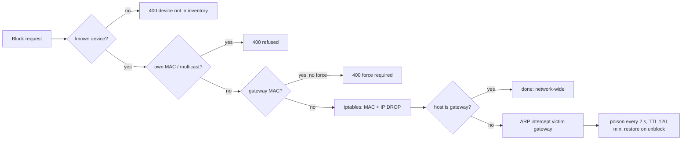

# CUTOFF architecture

## 1. Problem statement (IPO)

| Input | Processing | Output |
|---|---|---|
| local interface + subnet; user actions (scan / block / name / deauth / restore) | ARP or ICMP discovery, OUI + name resolution, inventory merge, topology-aware enforcement | device table, block state, audit events |

Constraints: Linux, **root for enforcement**, never modify the operator's
existing firewall policy, no external services, no cloud dependency.

## 2. Components

```
┌──────────────────────────── browser (127.0.0.1:8848) ───────────────────────────┐
│  index.html + app.js + style.css      token in header, poll every 6 s           │
└───────────────────────────────────┬─────────────────────────────────────────────┘
                                    │ JSON /api/*
┌───────────────────────────────────▼─────────────────────────────────────────────┐
│ app.py            routes, token auth, scan job (thread), static files           │
│   ├── discovery.py   ARP sweep → ping sweep → neighbour table; DNS/lease names  │
│   ├── store.py       atomic devices.json + append-only events.jsonl             │
│   ├── enforcer.py    guardrails + topology decision                              │
│   │     ├── firewall.py   CUTOFF_BLOCK chain, tagged MAC/IP DROP rules            │
│   │     ├── arpguard.py   bidirectional ARP black hole + restore                 │
│   │     └── wifi.py       hostapd_cli deauth / monitor-mode injection            │
│   └── netinfo.py     routes, interfaces, neighbours, DHCP leases                │
│         oui.py       offline vendor prefixes                                     │
└─────────────────────────────────────────────────────────────────────────────────┘
```

Dependency direction is one-way: routes → enforcer → {firewall, arpguard, wifi,
store}; discovery depends only on netinfo/oui/config. The firewall knows nothing
about HTTP, which is what makes it testable without a network.

## 3. Enforcement decision flow



Source: [`flows.mmd`](flows.mmd) (rendered with mermaid-cli).



## 4. Pseudocode (core loop)

```
BEGIN BlockDevice(mac, mode, force)
  device ← inventory[mac]                       # O(1) hash lookup
  IF device = NONE THEN RETURN error("scan first")
  IF mac ∈ own_macs OR mac is multicast THEN RETURN error("refused")
  IF mac = gateway_mac AND NOT force THEN RETURN error("force required")

  layers ← []
  firewall.block(mac, device.ip, mode)          # idempotent -C then -A
  IF layers applied THEN
     IF topology = host AND device.ip known THEN
        interceptor ← ARPInterceptor(gateway_ip, our_mac, device)
        interceptor.start()                     # raw AF_PACKET, refuses ip_forward
     ENDIF
  ENDIF
  inventory.record_block(mac, mode, simulated)
  audit.log("block", mac)
  RETURN {ok, layers, warnings, simulated}
END

BEGIN Scan()
  IF scan already running THEN RETURN 409
  network ← interface.network                    # /24 by default
  TRY  arp ← arpSweep(network)                   # O(n) frames, one socket
  CATCH permission
       pingSweep(network)                        # O(n) ICMP, 64 workers
       arp ← neighbourTable()
  ENDTRY
  names ← reverseDns(arp.keys) ∥ dhcpLeases()    # bounded thread pool
  FOR each (ip, mac) DO vendor ← OUI[mac[:3]]
  inventory.merge(results)                       # unseen → offline
END
```

## 5. Data model

`backend/data/devices.json`

```json
{
  "version": 1,
  "devices": {
    "aa:bb:cc:dd:ee:01": {
      "mac": "aa:bb:cc:dd:ee:01", "ip": "192.168.1.20",
      "vendor": "Apple", "hostname": "iphone", "name": "Alice's phone",
      "first_seen": "...", "last_seen": "...", "last_seen_epoch": 0,
      "active": true
    }
  },
  "blocks": {
    "aa:bb:cc:dd:ee:01": {
      "mode": "both", "strategy": "host", "simulated": false,
      "blocked_at": "..."
    }
  }
}
```

`events.jsonl` is append-only (`kind`, `mac`, `message`, `ok`, `simulated`,
`ts`), capped at 2000 entries on read. Writes use temp file + `os.replace` so a
crash cannot truncate the inventory.

Firewall rules are the source of truth for enforcement; `blocks` is the UI
mirror. `Restore all` reconciles both.

## 6. Layer responsibilities

| Layer | Owns | Never does |
|---|---|---|
| `app.py` | HTTP, auth, scan thread, static files | build iptables arguments |
| `enforcer.py` | policy: what is allowed, which layer applies | spawn sockets itself |
| `firewall.py` | rule lifecycle in INPUT/FORWARD/OUTPUT (src+dst MAC/IP), idempotency, cleanup | decide whether blocking is allowed |
| `arpguard.py` | frame format, refresh loop, restore | touch iptables |
| `wifi.py` | deauth transport selection | claim success without frames sent |
| `store.py` | durability and locking | network I/O |

This keeps coupling at the "message/interface" level: each module can be tested
with fakes, which is how the 57-test suite runs without root.

## 7. Concurrency

- One scan at a time (`_scan_lock`); the job runs in a daemon thread and the UI
  polls `/api/scan`.
- `Store` uses an `RLock` around mutations; all writes hit disk atomically.
- One `ArpInterceptor` per MAC, guarded by the enforcer lock; each has its own
  stop event, refresh thread and TTL.
- The frontend serialises refreshes through a promise chain so an action's
  refresh cannot be dropped by a concurrent poll.

## 8. Complexity

| Operation | Cost | Notes |
|---|---|---|
| ARP/ping sweep | O(n) hosts | n ≤ 1024 by default; ping path bounded by 64 workers |
| Inventory merge | O(n + d) | d = stored devices, capped at 1000 |
| Name resolution | O(n) DNS, ~1 s timeout each | parallel, failures ignored |
| Block / unblock | O(r) rules | r ≤ ~4 per device, `iptables -C` first for idempotency |
| Events read | O(k) tail | last k lines parsed |

Memory is O(devices + rules); a /24 with a few hundred hosts is trivial.

## 9. Failure modes and recovery

| Failure | Detection | Recovery |
|---|---|---|
| raw socket denied | `PermissionError` | ping fallback; banner explains |
| not root | `privileges()` | simulation mode; block modelled, not enforced |
| iptables missing | `find_binary` | block returns explicit error |
| ARP interception crash | TTL + `atexit` restore | victim's ARP cache returns to gateway |
| corrupt inventory | JSON decode error | file renamed `*.corrupt`, service continues |
| gateway blocked by mistake | guardrail + `Restore all` | chain flushed, all blocks cleared |
| scan on huge subnet | `SCAN_MAX_HOSTS` | 400-style error before any packet |

## 10. Design trade-offs

- **Separate chain vs. inline rules** — a dedicated `CUTOFF_BLOCK` chain keeps
  the operator's ruleset intact and makes cleanup a single jump removal.
- **MAC + IP vs. MAC only** — MAC survives DHCP changes but breaks under
  randomisation; IP is precise but lease-bound. Both are applied by default.
- **ARP interception vs. pure firewall** — interception is the only way to cut a
  neighbour's internet without owning the gateway. It is deliberately
  one-directional and never forwards, so it black-holes rather than MITMs.
- **Polling vs. WebSocket** — the dataset is tiny and changes on user action;
  6-second polling is simpler and survives backend restarts.


## Cross-platform layer (added)

`platform_ops.py` owns OS detection, privilege checks, Npcap detection and the
first-run provisioner. On Windows it silently installs Npcap 1.90 and downloads
the portable nmap/bettercap builds; on Linux it only verifies the bundled
binaries. `firewall.create()` selects `firewall_win.WindowsFirewall` (netsh
rules, IP-level) on Windows and the iptables `Firewall` on Linux. `enforcer.py`
imports `arpguard_win` on Windows, where the same bidirectional ARP black hole
is sent with scapy through Npcap instead of AF_PACKET. The Windows block is
refused if the ARP layer cannot start, because Windows Firewall alone only
filters traffic to/from that PC.


## IPv6 layer (added)

IPv6 bypasses the ARP black hole, so it gets its own inventory and its own
enforcement path.

**Inventory.** `ipv6.py` reads `ip -6 addr` (addresses, prefixes, lifetimes,
SLAAC/privacy/deprecated flags) and `ip -6 neigh` (address → MAC, NDP state,
router flag). Parsing is separated from execution (`parse_addresses`,
`parse_neighbours`) so both are unit-tested against fixture text. `discovery.scan`
calls `ipv6.attach(devices, iface)` after fingerprinting: the MAC is the join
key, addresses are ordered global → ULA → link-local, capped at 8 per device,
and a device whose addresses left the NDP cache gets an empty list instead of a
stale blockable value. `store.upsert_scan` merges the `ip6` key when present, so
persistence and clearing follow the same rule.

**Enforcement.** Two chains per family exist because `xt_mac` is only valid in
PREROUTING/LOCAL_IN/FORWARD: a MAC rule makes a chain unusable from OUTPUT.

```
INPUT   ──┐                    ┌── INPUT
FORWARD ──┴─> CUTOFF_BLOCK      │   (ip4 + ip6)
OUTPUT  ────> CUTOFF_OUT        │
```

- `CUTOFF_BLOCK` — MAC rules (`-m mac --mac-source`), `-s`/`-d` L3 rules,
  prefix rules. Hooked at position 1 of INPUT and FORWARD.
- `CUTOFF_OUT` — the same `-s`/`-d` and prefix rules without any MAC match.
  Hooked at position 1 of OUTPUT.
- Rule identity is the comment `CUTOFF:<mac|pfx>:<id>:<scope>`, scopes
  `l2/l3/l3out` (v4) and `v6l2/v6l3/v6l3out/pfxl3/pfxout` (v6). `parse_tag`
  still accepts the legacy `CUTOFF:<mac>:<scope>` form, and `ensure()` deletes a
  stale `OUTPUT -j CUTOFF_BLOCK` jump left by older builds.
- `list_rules()` reads `-S` from both chains in both families and collapses the
  `-s`/`-d` twin into one row per (chain, scope) identity for display.

**Guards.** `ipv6.valid_prefix` refuses non-v6 input, anything wider than `/16`
and `/128`; `Enforcer.block_ipv6_prefix` additionally refuses a prefix that
contains an address of this host unless `force=true`. `Enforcer.block(ip6=…)`
takes the address list from the inventory, dedupes it, and records it in the
block record so `restore_blocks()` re-applies it after a restart.

**Simulation.** `Firewall._sim` holds the rules a simulated run would install.
`list_rules()` renders them with `simulated: true`, so the IPv6 page shows the
modelled ruleset instead of an empty table next to a successful block. `panic()`
clears the model.

**Windows.** `WindowsFirewall.block(mac, ip, mode, ip6=…)` writes
`remoteip=<addr>` rules for both families. Windows Firewall can match IPv6
addresses but not MACs; the ARP layer stays IPv4-only, which the UI states.
